# Automatisation de processus d'entreprise avec Python


Projet d'automatisation de bout en bout : **six automatisations Python enchaînées en un pipeline** qui surveille un stock, envoie les alertes, remplit le formulaire de commande urgente, compile la production de la semaine, relève les prix d'un catalogue en ligne et relance le tout à son rythme. La routine qui demandait d'ouvrir des fichiers Excel, de recopier des listes et de surveiller des sites tourne désormais **seule, en boucle, en moins d'une seconde par cycle**.

[](https://automatisation-de-processus-cedric.streamlit.app)
[](https://gomugomuno01.github.io/automatisation-de-processus/presentation/)
[-217346?style=for-the-badge&logo=microsoftexcel&logoColor=white)](data/inventaire_gaming_multimedia.xlsx)

*Démo : l'application complète, « Relais », hébergée gratuitement sur Streamlit Community Cloud ; si elle était en veille, elle peut mettre quelques instants à démarrer. En indiquant votre adresse dans la démo, vous recevez l'alerte de stock dans votre boîte mail. Présentation : le projet en 40 secondes de motion design, sur une musique originale. Inventaire : un des trois fichiers Excel d'exemple, à importer dans la démo après avoir modifié quelques quantités.*

[](https://gomugomuno01.github.io/automatisation-de-processus/presentation/)

*La présentation vidéo (40 s, 1080p, avec le son) : cliquer sur l'image pour la regarder sur GitHub Pages. Elle montre la routine manuelle, le pipeline qui détecte les ruptures et décide (email, formulaire), les six automatisations, les deux rythmes de planification, la démo en ligne et les chiffres clés. Elle est animée image par image en Python, sur une musique électro composée et synthétisée pour elle, sans aucun droit à céder.*

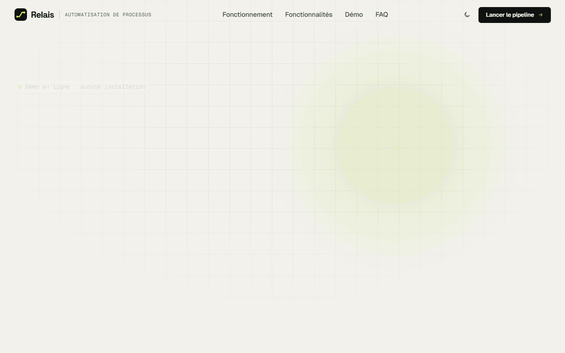

*L'application en action : un clic sur « Lancer le pipeline » exécute les six automatisations sur le serveur. Chaque étape s'affiche en direct avec sa décision (« 12 ruptures ≥ seuil 3 : formulaire déclenché ») et le journal, puis les résultats s'ouvrent par automatisation : stock, email, formulaire, production, prix et planification, avec les fichiers à télécharger.*

---

## Sommaire

1. [Le projet en bref](#1-le-projet-en-bref)
2. [Les résultats en bref](#2-les-résultats-en-bref)
3. [Contexte et objectifs](#3-contexte-et-objectifs)
4. [Problématiques traitées](#4-problématiques-traitées)
5. [Données utilisées](#5-données-utilisées)
6. [Outils et technologies](#6-outils-et-technologies)
7. [Méthodologie](#7-méthodologie)
8. [Étapes de réalisation](#8-étapes-de-réalisation)
9. [Les fichiers générés](#9-les-fichiers-générés)
10. [Analyses et résultats détaillés](#10-analyses-et-résultats-détaillés)
11. [Utilisation au quotidien](#11-utilisation-au-quotidien)
12. [Principaux enseignements](#12-principaux-enseignements)
13. [Structure du projet](#13-structure-du-projet)
14. [Reproduire le projet](#14-reproduire-le-projet)
15. [Limites et pistes d'amélioration](#15-limites-et-pistes-damélioration)
16. [Crédits](#16-crédits)

---

## 1. Le projet en bref

> **En une phrase :** j'ai remplacé une routine manuelle et répétitive (contrôler les stocks, prévenir, commander en urgence, compiler la production, relever les prix) par un pipeline qui s'exécute seul et décide, à chaque cycle, de ce qui doit partir.

### La situation

Dans une entreprise qui gère des stocks, quelqu'un ouvre chaque matin les fichiers Excel d'inventaire pour repérer les produits sous leur seuil. S'il en trouve, il rédige un email d'alerte et recopie la liste ; si la situation est critique, il remplit un bon de commande urgent en ligne. Le vendredi, il additionne la production des cinq jours ; plusieurs fois par semaine, il relève les prix des concurrents site par site. Rien de difficile, mais **tout est manuel, répétitif, et dépend de sa présence**.

### Ce que j'ai fait

| Étape | En pratique |
|---|---|
| **Découper la routine** | Six tâches indépendantes, une par script : détection des ruptures, rapport hebdomadaire, alerte email, planification, scraping, formulaire |
| **Détecter les ruptures** | Lecture de l'inventaire Excel, règle `Quantite ≤ Seuil_Minimum`, rapport d'alerte horodaté |
| **Prévenir et agir** | Email HTML avec le rapport en pièce jointe dès la première rupture ; formulaire d'urgence rempli et soumis par un navigateur automatisé au-delà d'un seuil |
| **Compiler et surveiller** | Fusion des CSV de production en un classeur à deux onglets ; relevé d'un catalogue en ligne (nom, prix, description, note) |
| **Automatiser** | Un pipeline qui enchaîne les cas et deux modes de planification : TEST (minutes) pour valider, PRODUCTION (heures, vendredi 8 h) pour l'usage réel |
| **Centraliser la configuration** | Un seul fichier `.env` ; une variable manquante est signalée clairement plutôt que de faire planter le programme plus loin |
| **Rendre le projet testable par tous** | Une application web au design propre (« Relais ») qui lance le vrai pipeline depuis le navigateur, avec inventaire modifiable ou importé, et l'alerte reçue pour de vrai dans sa boîte mail, sans installation |
| **Mettre en ligne** | Démo publique hébergée gratuitement sur Streamlit Community Cloud, redéployée à chaque push, gardée éveillée par une visite automatique toutes les 6 heures |
| **Présenter le projet** | Une vidéo de 40 s en motion design, animée image par image en Python, sur une musique originale composée par code, publiée sur GitHub Pages |
| **Vérifier chaque résultat** | 108 tests automatisés (fonctions partagées, import, pipeline, envoi d'email, API web), lancés par GitHub Actions à chaque push |

### Ce que ce projet démontre

- **Sens du résultat** : partir d'une routine réelle et la supprimer étape par étape, avec un livrable concret à chaque fois (fichier Excel, email, formulaire soumis).
- **Logique de décision** : le pipeline ne fait pas tout à chaque fois ; il décide (aucune rupture : pas d'email ; ruptures sous le seuil : pas de formulaire) et le dit.
- **Automatisation du web** : un navigateur piloté par Selenium qui lit un catalogue et remplit un formulaire champ par champ, et sa version sans navigateur pour l'hébergement en ligne.
- **Organisation du code** : six scripts autonomes, un orchestrateur, une configuration centralisée, deux interfaces (ligne de commande et application web) branchées sur les mêmes fonctions.
- **Pensée utilisateur** : deux questions suffisent pour tout lancer en local ; en ligne, un clic, et une prévision en direct de ce qui va se déclencher.
- **Soin du produit** : une interface conçue comme un produit fini, avec un design system, des animations qui expliquent le pipeline et une accessibilité vérifiée.
- **Rigueur** : tests automatisés, vérification en production, et des corrections trouvées en cours de route (une note de scraping toujours à 0, des jours triés dans le désordre, un décalage horaire chez l'hébergeur).
- **Autonomie** : projet mené seul de bout en bout, de l'identification du besoin au déploiement.

### Pour découvrir le travail en 2 minutes

1. Regarder la [présentation vidéo](https://gomugomuno01.github.io/automatisation-de-processus/presentation/) (40 s).
2. Ouvrir la [démo en ligne](https://automatisation-de-processus-cedric.streamlit.app) et cliquer sur **Lancer le pipeline**.
3. Descendre jusqu'à la **démo interactive** : modifier une quantité, régler le seuil, et observer la prévision changer avant de relancer.
4. À l'étape 03 de la démo, indiquer son adresse email : l'alerte arrive pour de vrai, rapport Excel en pièce jointe.
5. Parcourir [les fichiers générés](#9-les-fichiers-générés).
6. Lire [les résultats détaillés](#10-analyses-et-résultats-détaillés).

## 2. Les résultats en bref

**Le constat.** Le contrôle des stocks, l'alerte, la commande urgente, le rapport de la semaine et le relevé des prix étaient faits à la main, au fil des jours. Le pipeline exécute l'ensemble en **moins d'une seconde par cycle** (environ 0,6 s mesurées en production, dont 0,5 s pour lire le catalogue en ligne), puis recommence seul selon le mode choisi.

**Ce que l'outil apporte**

1. **Une surveillance continue** : le stock est contrôlé toutes les heures en mode PRODUCTION, sans que personne n'ait à ouvrir un fichier.
2. **Des alertes immédiates et proportionnées** : un email dès la première rupture, un formulaire d'urgence seulement au-delà du seuil réglé.
3. **Des livrables homogènes** : les mêmes fichiers Excel horodatés à chaque cycle, prêts à être ouverts ou archivés.

**Les livrables**

| Livrable | Lien |
|---|---|
| Application web de démonstration | [Ouvrir la démo](https://automatisation-de-processus-cedric.streamlit.app) |
| Inventaires d'exemple (Excel, 20 produits chacun) | [gaming](data/inventaire_gaming_multimedia.xlsx) · [bureau](data/inventaire_consommables_bureau.xlsx) · [stockage](data/inventaire_stockage_securite.xlsx) |
| Production d'exemple (5 CSV journaliers par inventaire) | [data/production/](data/production/) |
| Guide de mise en ligne (Streamlit Cloud, Render, Cloud Run, Docker) | [docs/DEPLOIEMENT.md](docs/DEPLOIEMENT.md) |
| Présentation vidéo (40 s, musique originale libre de droits) | [Voir la présentation](https://gomugomuno01.github.io/automatisation-de-processus/presentation/) |
| Musique originale de la vidéo (MP3, libre de droits) | [musique.mp3](assets/video/musique.mp3) |
| Générateur de la vidéo et de la musique (Python) | [assets/video/source/](assets/video/source/) |

## 3. Contexte et objectifs

**L'entreprise** est une structure (fictive) qui gère trois familles de stock : gaming et multimédia, consommables de bureau, stockage et sécurité. Chaque famille a son fichier d'inventaire Excel et sa production journalière en CSV.

**Scénario.** Les stocks évoluent chaque jour ; un produit qui passe sous son seuil minimum doit être signalé, et une situation critique doit déclencher une commande urgente. L'objectif est de fournir un outil qui :

- **surveille le stock sans intervention**, à intervalle régulier ;
- **prévient la bonne personne** avec les bonnes informations, dès qu'il le faut ;
- **agit seul** quand la situation dépasse un seuil ;
- **produit les rapports récurrents** (production de la semaine, prix du marché) ;
- **peut être essayé par n'importe qui**, sans compétence technique ni installation.

**Trois scénarios types**, imaginés pour illustrer le projet :

| Profil | Besoin | Ce que fait le pipeline |
|---|---|---|
| Marie, responsable logistique | « Je surveille quatre entrepôts. Avant, j'ouvrais chaque fichier Excel le matin. » | Mode PRODUCTION : contrôle chaque heure, alerte dès la première rupture, rapport le vendredi à 8 h |
| Thomas, acheteur | « Je compare nos prix à ceux des concurrents chaque semaine. » | Le catalogue est relevé toutes les 4 h et exporté en Excel |
| Léa, assistante administrative | « Quand les fournitures manquent, je dois remplir un bon de commande urgent. » | Au-delà de 3 ruptures, le formulaire est rempli et soumis tout seul |

## 4. Problématiques traitées

| # | Question | Partie prenante |
|---|---|---|
| 1 | Comment repérer automatiquement les produits sous leur seuil, produit par produit ? | Logistique |
| 2 | Comment prévenir immédiatement, avec la liste exacte et un fichier exploitable ? | Responsable des achats |
| 3 | Comment déclencher une commande urgente sans intervention quand la situation devient critique ? | Services généraux |
| 4 | Comment consolider la production de la semaine sans additionner cinq fichiers à la main ? | Production |
| 5 | Comment suivre les prix d'un catalogue en ligne sans les relever un par un ? | Achats |
| 6 | Comment faire tourner tout cela en continu, à un rythme adapté à chaque tâche ? | Tous |
| 7 | Comment permettre à une personne non technique de tester l'outil sans rien installer ? | Recruteurs, futurs utilisateurs |

**Règle centrale : un produit est en rupture quand `Quantite ≤ Seuil_Minimum`.** Le nombre de ruptures décide de la suite : email s'il y en a au moins une, formulaire d'urgence s'il atteint `SEUIL_DECLENCHEMENT_FORMULAIRE` (3 par défaut).

## 5. Données utilisées

| Élément | Détail |
|---|---|
| Inventaires | 3 fichiers Excel de 20 produits : [gaming et multimédia](data/inventaire_gaming_multimedia.xlsx), [consommables de bureau](data/inventaire_consommables_bureau.xlsx), [stockage et sécurité](data/inventaire_stockage_securite.xlsx) |
| Production | 5 fichiers CSV par inventaire (`Lundi.csv` à `Vendredi.csv`), 5 produits et 25 lignes par semaine, dans [`data/production/`](data/production/) |
| Catalogue en ligne | boutique de test publique [webscraper.io](https://webscraper.io/test-sites/e-commerce/allinone), une catégorie par inventaire (téléphones, tablettes, ordinateurs) |
| Formulaire | formulaire de test public de [selenium.dev](https://www.selenium.dev/selenium/web/web-form.html) |
| Nature | données fictives, conçues pour contenir des ruptures (12, 7 et 9 selon l'inventaire) |
| Dans la démo | inventaires d'exemple modifiables, ou import d'un fichier personnel (.xlsx ou .csv) |

### Structure attendue de l'inventaire

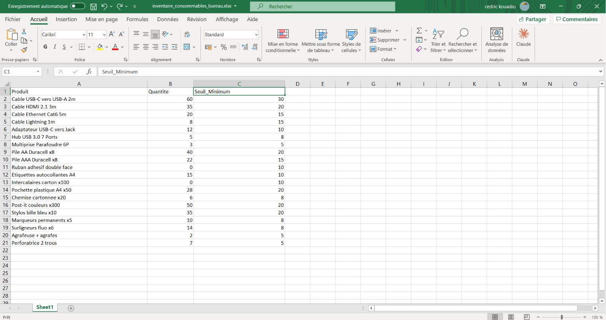

| Colonne | Type | Exemple | Description |
|---|---|---|---|
| `Produit` | Texte | `Hub USB 3.0 7 Ports` | Nom du produit |
| `Quantite` | Entier | `5` | Stock actuel |
| `Seuil_Minimum` | Entier | `8` | Quantité en dessous de laquelle (ou égale à laquelle) le produit est en rupture |

Dans la démo en ligne, l'import tolère les accents et les variantes de noms de colonnes (`Quantité`, `Seuil minimum`…), le point-virgule comme séparateur, et accepte jusqu'à 300 produits.

### Structure des fichiers de production

| Colonne | Type | Exemple | Description |
|---|---|---|---|
| `Produit` | Texte | `Stylos` | Produit fabriqué |
| `Quantite_Produite` | Entier | `1200` | Unités produites ce jour |
| `Ligne_Production` | Texte | `B1` | Ligne d'assemblage |

Le nom du fichier donne le jour (`Mardi.csv`) ; les jours sont remis dans l'ordre de la semaine avant la fusion.

## 6. Outils et technologies

| Outil | Utilisation dans le projet |
|---|---|
| **Python 3.11+** | Langage de l'ensemble du projet |
| **pandas / openpyxl** | Lecture des inventaires et CSV, détection des ruptures, fusion, agrégation, écriture des classeurs Excel |
| **smtplib / email (MIME)** | Email d'alerte HTML avec le rapport Excel en pièce jointe, envoyé par Gmail (SMTP SSL) |
| **Selenium** | Chrome sans interface : lecture du catalogue en ligne (Cas 5) et remplissage du formulaire (Cas 6) |
| **schedule** | Planification des trois tâches récurrentes, modes TEST et PRODUCTION |
| **python-dotenv** | Configuration centralisée dans `.env` |
| **urllib / html.parser** | En ligne : les mêmes automatisations web par requêtes HTTP, sans navigateur |
| **HTML, CSS, JavaScript** | Interface web sans framework : design system à base de tokens, système d'animation centralisé, graphiques natifs (HTML/CSS) |
| **Streamlit (`st.App`) / Starlette** | Serveur web : sert l'interface et l'API du pipeline (progression en direct) |
| **pytest** | 108 tests automatisés (fonctions partagées, import, pipeline, envoi d'email, API web) ; aucun test n'envoie de vrai email |
| **Streamlit Community Cloud** | Hébergement gratuit de la démo en ligne, redéployée à chaque push sur `main` |
| **GitHub Actions** | Tests à chaque push, visite automatique de la démo toutes les 6 heures (Playwright) |
| **Docker** | Image prête pour l'hébergement (Google Cloud Run, Render) |
| **Pillow, numpy, ffmpeg** | Vidéo de présentation : 1 200 images dessinées en Python, musique synthétisée par code, encodage H.264 + AAC |
| **GitHub Pages** | Publication de la page de présentation vidéo |
| **Git / GitHub** | Versionnage, branches `main` et `dev` |

## 7. Méthodologie

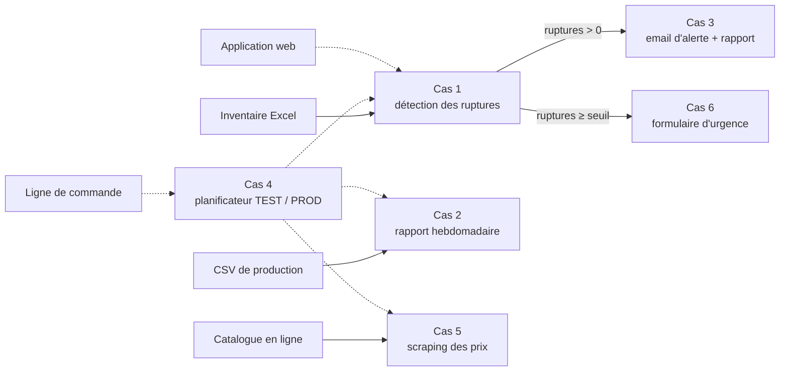

Trois principes ont guidé le travail :

1. **Un cas, un script** : chaque automatisation est un fichier indépendant, exécutable seul. Le pipeline les assemble sans les réécrire, et l'application web appelle les mêmes fonctions.
2. **Décider, puis le dire** : chaque cycle affiche ce qu'il a trouvé et pourquoi il agit ou non (« 7 ruptures < seuil 10 : formulaire non déclenché »).
3. **Échouer clairement** : une variable de configuration absente arrête le programme avec un message qui la nomme ; une étape web qui échoue (site injoignable) est signalée sans bloquer les autres.

## 8. Étapes de réalisation

### 8.1 Cas 1 : détection des ruptures

- Lecture de l'inventaire Excel avec pandas, puis la règle centrale :

```python
def detecter_ruptures(df: pd.DataFrame) -> pd.DataFrame:
    """Produits dont la quantité est inférieure ou égale au seuil, marqués RUPTURE."""
    alertes = df[df["Quantite"] <= df["Seuil_Minimum"]].copy()
    alertes["Statut"] = "RUPTURE"
    return alertes
```

- Rapport `rapport_alerte_AAAA-MM-JJ_HH-MM.xlsx` (même quand le stock est nominal, pour garder une trace de chaque contrôle).
- Le nombre de ruptures est renvoyé au pipeline, qui décide de la suite.

### 8.2 Cas 3 : alerte email

- Email HTML : tableau des produits en rupture (quantité en rouge, seuil), date et heure du contrôle.
- Le rapport Excel du Cas 1 est joint au message (MIME, encodage base64).
- Envoi par Gmail en SMTP SSL (port 465) avec un mot de passe d'application ; les noms de produits sont échappés dans le HTML.

| Envoyé depuis la ligne de commande | Envoyé depuis la démo en ligne |
|---|---|
| 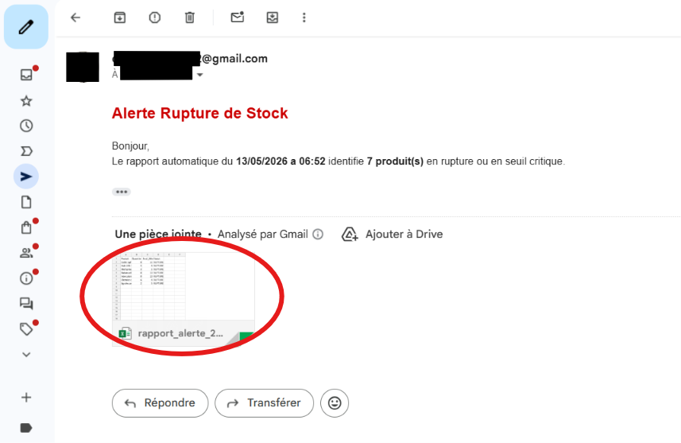 | 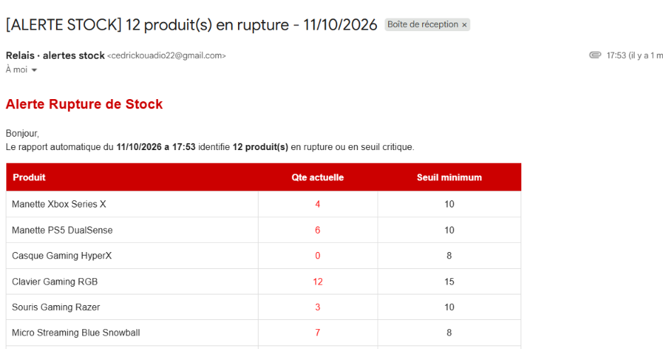 |

*À droite, l'alerte déclenchée depuis la [démo en ligne](https://automatisation-de-processus-cedric.streamlit.app) : le visiteur a indiqué son adresse à l'étape 03, et l'email est arrivé en quelques secondes, expédié par « Relais · alertes stock » avec le rapport Excel en pièce jointe.*

### 8.3 Cas 6 : formulaire d'urgence

- Déclenché seulement si le nombre de ruptures atteint le seuil réglé.
- Chrome sans interface ouvre le formulaire, attend qu'il soit chargé (`WebDriverWait`), remplit chaque champ (texte, mot de passe, zone de texte, liste déroulante par son texte visible) et le soumet.
- La page de confirmation (« Form submitted · Received! ») atteste la soumission.

### 8.4 Cas 2 : rapport hebdomadaire

- Lecture des cinq CSV journaliers, ajout d'une colonne `Jour`, remise dans l'ordre de la semaine, fusion.
- Classeur à deux onglets : **Detail journalier** (toutes les lignes) et **Recapitulatif semaine** (total par produit, trié).

### 8.5 Cas 5 : scraping des prix

- Chrome sans interface charge la catégorie du catalogue associée à l'inventaire.
- Pour chaque fiche produit : nom (`.title`), prix (`.price`), description (`.description`) et note sur 5 (attribut `data-rating`).
- Export `scraping_produits_AAAA-MM-JJ_HH-MM.xlsx`.

### 8.6 Cas 4 et pipeline : planification

- `python main.py` pose deux questions (inventaire, mode), puis le planificateur exécute immédiatement un premier cycle de surveillance et relance chaque tâche à son rythme :

| | Mode TEST | Mode PRODUCTION |
|---|---|---|
| Surveillance du stock (Cas 1 → 3 → 6) | toutes les minutes | toutes les heures |
| Rapport hebdomadaire (Cas 2) | toutes les 2 minutes | chaque vendredi à 8 h |
| Scraping des prix (Cas 5) | toutes les 3 minutes | toutes les 4 heures |
| Objectif | valider le pipeline en quelques minutes | usage réel, surveillance continue |

- Tous les intervalles viennent du fichier `.env` ; `config.py` les lit et lève une erreur explicite si l'un manque.

### 8.7 Application web

L'interface est un frontend sur mesure, sans framework ni étape de build, servi avec son API par `st.App` (Streamlit 1.65). Elle appelle **les mêmes fonctions que la ligne de commande** (`detecter_ruptures`, `fusionner`, `construire_message`, la bibliothèque `schedule` et les intervalles du `.env`). La [démo en ligne](https://automatisation-de-processus-cedric.streamlit.app) est hébergée gratuitement sur Streamlit Community Cloud.

| Accueil | Fonctionnement |
|---|---|
| 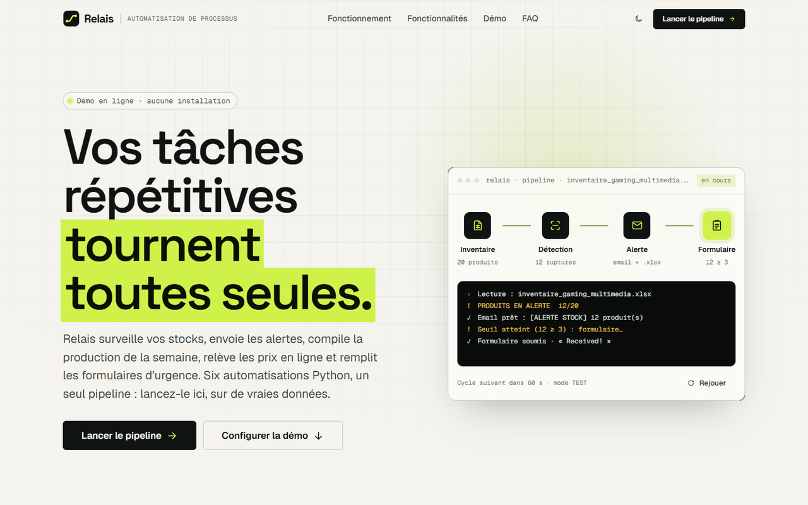 | 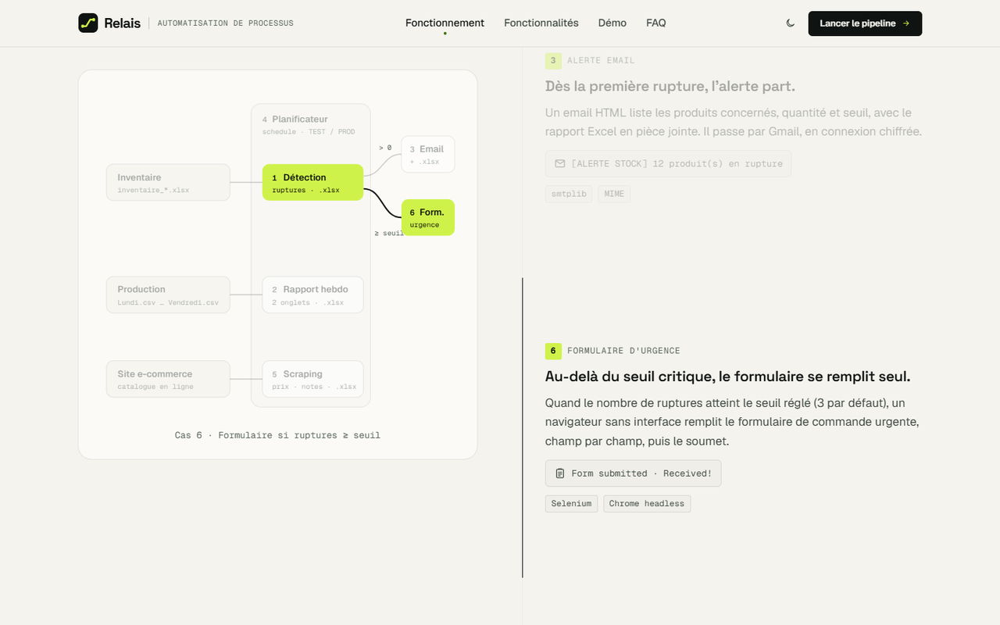 |
| **Démo interactive** | **Exécution en direct** |
| 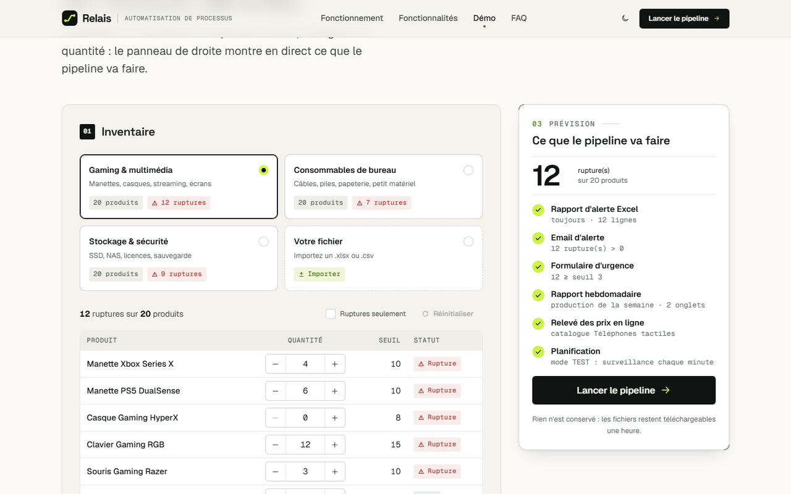 | 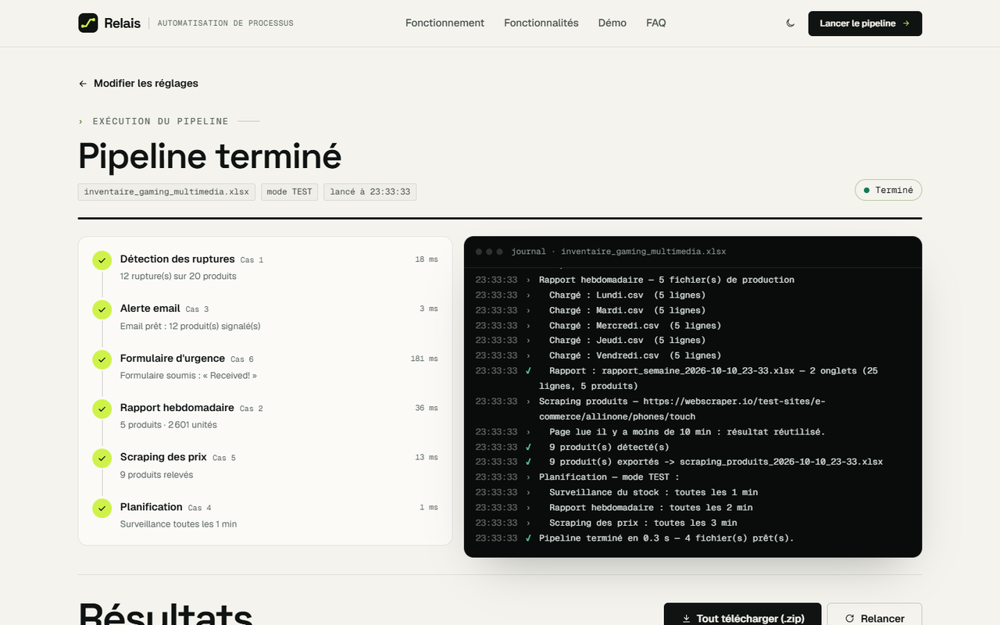 |

| Résultats | Thème sombre | Mobile |
|---|---|---|
| 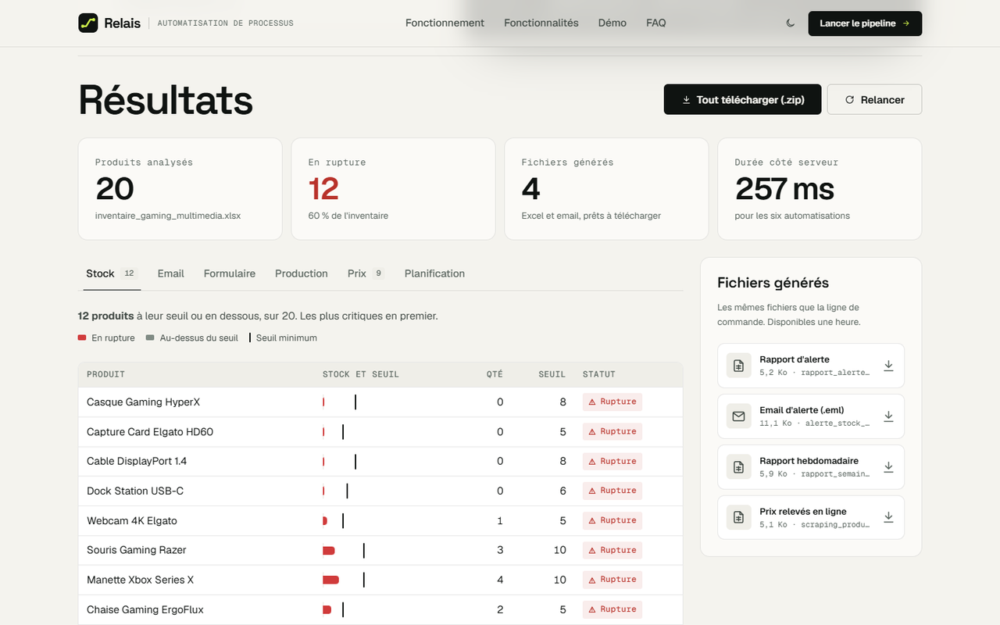 | 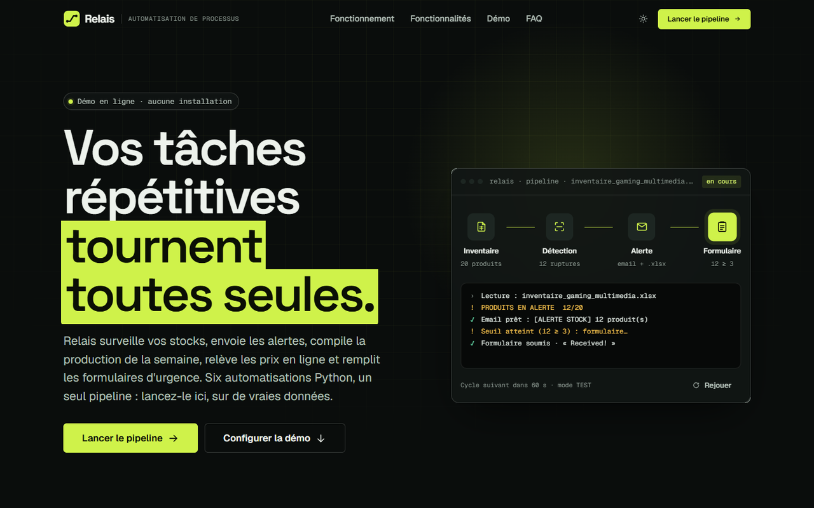 | 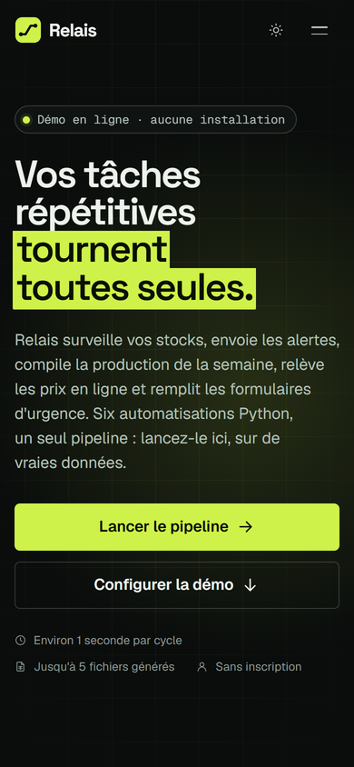 |

**Parcours**
- **Lancement en un clic** : le pipeline complet sur l'inventaire gaming (12 ruptures), mode TEST, seuil 3.
- **Démo interactive** : choix d'un des trois inventaires ou import d'un fichier personnel (.xlsx ou .csv, avec les CSV de production en option), quantités modifiables dans le tableau, mode TEST ou PRODUCTION, seuil du formulaire, étapes facultatives. Un panneau **Prévision** montre en direct ce qui va se déclencher et pourquoi.
- **Alerte reçue pour de vrai** : à l'étape 03 de la démo, le visiteur renseigne `EMAIL_DESTINATAIRE` (et, s'il le souhaite, `EMAIL_EXPEDITEUR`) ; l'alerte du Cas 3 arrive dans sa boîte, rapport Excel en pièce jointe. Sans adresse, l'email se télécharge en `.eml`.
- **Progression en direct** : le serveur envoie l'avancement réel de chaque étape (flux NDJSON) ; les étapes, leurs décisions et le journal s'affichent au fur et à mesure.
- **Résultats par automatisation** : stock (barres quantité et repère du seuil), email (aperçu isolé dans un cadre sans script), formulaire (champs saisis et réponse du site), production (barres et détail jour par jour), prix (prix bas, moyen, haut, notes), planification (calendrier des deux modes calculé par `schedule`).
- **Téléchargements** : les mêmes fichiers que la ligne de commande, un par un ou réunis en .zip.
- **Thème clair ou sombre** : la page suit le réglage du système, un bouton permet de basculer, et le choix est mémorisé.

**Ce qui change en ligne**

| | Ligne de commande (`python main.py`) | Application web (`app.py`) |
|---|---|---|
| Rythme | en boucle, selon le mode | un cycle par clic ; la planification est affichée |
| Fichiers | écrits dans `output/<inventaire>/` | gardés en mémoire 1 heure, téléchargeables |
| Email (Cas 3) | envoyé par Gmail depuis le compte du `.env` | envoyé à l'adresse saisie par le visiteur, depuis le compte Gmail de la démo (son adresse d'expéditeur va en « Répondre à ») ; sans adresse, téléchargeable en `.eml` |
| Cas 5 et 6 | Selenium pilote Chrome | requêtes HTTP sur les mêmes pages (aucun Chrome chez l'hébergeur), avec copie de secours du catalogue |
| Heure | celle du poste | heure française (l'hébergeur tourne en UTC) |

**Design system** ([`tokens.css`](webapp/static/assets/css/tokens.css))
- Une identité propre, différente des autres projets du portfolio : une « salle de contrôle » sobre (graphite, papier, un seul signal vert-volt), Space Grotesk pour les titres, Geist et Geist Mono pour le texte et tout ce que la machine écrit (journaux, fichiers, horaires).
- Une seule source de vérité pour les couleurs (thème clair et thème sombre composés, pas inversés), la typographie fluide (`clamp()`), les espacements (4 à 128 px), les rayons, les ombres et les plans.
- Des composants réutilisables : bouton (survol, actif, focus, désactivé, chargement, succès), carte, champ, compteur, interrupteur, contrôle segmenté, zone de dépôt, tableau, onglets, accordéon, infobulle, toast, fenêtre de dialogue, console, étapes.
- Les couleurs des graphiques ont été validées (contraste et daltonisme) : une rupture est signalée en rouge **avec une icône et un libellé**, et les produits au-dessus du seuil sont en gris, car un couple rouge / vert ne se distingue pas en deutéranopie.

**Système d'animation** ([`motion.js`](webapp/static/assets/js/motion.js) et tokens `--dur-*`)
- Durées et courbes partagées (micro-interaction 120 ms, survol 180 ms, composant 260 ms, transition 380 ms, animation complexe 640 ms), amplitudes plafonnées à 20 px, déplacements uniquement en `transform` et `opacity`.
- Le tableau de bord du hero joue un cycle de surveillance une fois, puis s'arrête (bouton « Rejouer ») ; le diagramme « Fonctionnement » suit l'étape lue au défilement ; transitions de vue (View Transitions API, avec repli).
- Effets liés au curseur (projecteur, légère parallaxe, boutons magnétiques de 4 px) réservés à la souris.
- Avec `prefers-reduced-motion`, plus rien ne bouge : le contenu et l'état final s'affichent directement.

**Accessibilité et responsive**
- Navigation complète au clavier (lien d'évitement, onglets aux flèches, focus visible), annonces `aria-live` de la progression, erreurs affichées sous le champ concerné.
- Conception mobile d'abord, sans débordement horizontal, du smartphone au grand écran.
- Page d'accueil légère : environ 114 Ko transférés en 18 requêtes, aucun framework, trois polices variables auto-hébergées (75 Ko au total).

**Robustesse côté serveur**
- Rien n'est écrit sur le disque : les fichiers importés et générés restent en mémoire, une heure au plus, derrière un identifiant aléatoire.
- Les envois sont contrôlés (2 Mo par fichier, 300 produits, 7 fichiers de production) et les noms de fichiers nettoyés ; les téléchargements d'exemples passent par une liste blanche.
- Trois pipelines au plus en parallèle ; le catalogue en ligne est lu au plus une fois toutes les 10 minutes, pour ménager le site.
- L'envoi réel de l'email est encadré pour ne pas devenir un relais de spam : contenu verrouillé (inventaire d'exemple, seules les quantités changent, noms de produits vérifiés côté serveur), adresses validées (aucune injection d'en-tête possible), et limites de 3 envois par heure et par visiteur, 2 par adresse et par jour, 50 par jour au total. Les identifiants du compte d'envoi restent dans les secrets de l'hébergeur.

### 8.8 Vidéo de présentation

Une vidéo de 40 secondes présente le projet à quelqu'un qui n'ouvrira jamais le code : [la regarder](https://gomugomuno01.github.io/automatisation-de-processus/presentation/).

- **Animée image par image en Python** : 1 200 images 1080p dessinées avec Pillow (en 3840×2160 puis réduites, pour des contours lisses), rendues en parallèle sur tous les cœurs en une quarantaine de secondes, puis encodées en H.264 avec ffmpeg.
- **Une charte propre, « Signal »** : le pupitre d'une salle de contrôle, différent des vidéos des autres projets du portfolio. Fond graphite quadrillé, un seul signal vert-volt, Space Grotesk et Geist Mono, impulsions qui courent le long des fils, instrumentation de bord (chapitre, minutage, avancement), transitions en ligne de balayage, volets, grille qui commute et barre de relais.
- **Sept scènes** calées sur 20 mesures à 120 BPM : le constat, le pipeline qui décide, les six automatisations, les deux rythmes de planification, la démo en ligne et les chiffres clés.
- **Une musique originale** : électro minimale en ré mineur, entièrement synthétisée avec numpy (kick, clap, « clics de relais », basse roulante, arpège, nappes, cloches), sans aucun échantillon ni extrait d'une œuvre existante. Elle suit l'image : une note à chaque nœud du pipeline, une par carte allumée, le clic et la notification de la démo.
- **Publiée sur GitHub Pages** par le workflow [`deploy-pages.yml`](.github/workflows/deploy-pages.yml), avec une page dédiée (chapitres cliquables, musique téléchargeable). Le générateur et sa documentation sont dans [`assets/video/source/`](assets/video/source/).

### 8.9 Contrôle qualité

| Fichier de tests | Ce qui est vérifié |
|---|---|
| [`tests/test_service.py`](tests/test_service.py) | Règle de rupture, fusion dans l'ordre de la semaine, échappement HTML de l'email, inventaires d'exemple, import (.xlsx, .csv à point-virgule, erreurs explicites), validation, planification TEST et PRODUCTION, pipeline complet et ses décisions, panne du formulaire, copie de secours du catalogue, cache ; envoi réel de l'email (adresses, injection d'en-tête, contenu verrouillé, « Répondre à », limites par visiteur et par adresse, panne SMTP) |
| [`tests/test_navigateur.py`](tests/test_navigateur.py) | Extraction des produits comme Selenium, HTML mal fermé, valeurs envoyées par un vrai navigateur (champs désactivés, cases cochées, option sélectionnée), choix par texte visible |
| [`tests/test_api.py`](tests/test_api.py) | Pages et fichiers statiques (cache, compression), inventaires, import, flux du pipeline (jamais compressé), téléchargements et archive, validations 400 (le proxy de Streamlit Cloud masque les 422), exemples sur liste blanche, identifiants inconnus |

Les deux sites de test sont simulés dans les tests : ils ne dépendent pas du réseau. L'envoi SMTP est remplacé pour tous les tests ([`tests/conftest.py`](tests/conftest.py)) : même avec de vrais identifiants dans le `.env`, aucun email ne part. L'interface a en plus été vérifiée dans un vrai navigateur (Chrome sans interface) : bureau et mobile, thèmes clair et sombre, clavier seul, mouvement réduit, import d'un fichier, puis en production sur Streamlit Community Cloud.

## 9. Les fichiers générés

Chaque cycle produit jusqu'à quatre fichiers horodatés (plus l'email). Les aperçus ci-dessous viennent de la démo en ligne, inventaire gaming, mode TEST, seuil 3.

| Fichier | Aperçu dans la démo | Contenu |
|---|---|---|
| `rapport_alerte_*.xlsx` (Cas 1) | 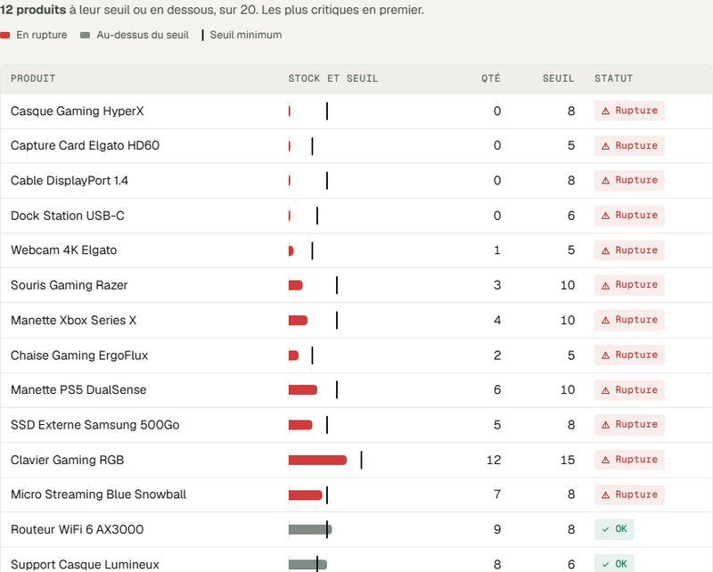 | Les produits en rupture avec `Produit`, `Quantite`, `Seuil_Minimum`, `Statut = RUPTURE`. Dans la démo, chaque produit est montré face à son seuil, les plus critiques en premier |
| Email d'alerte (Cas 3) | 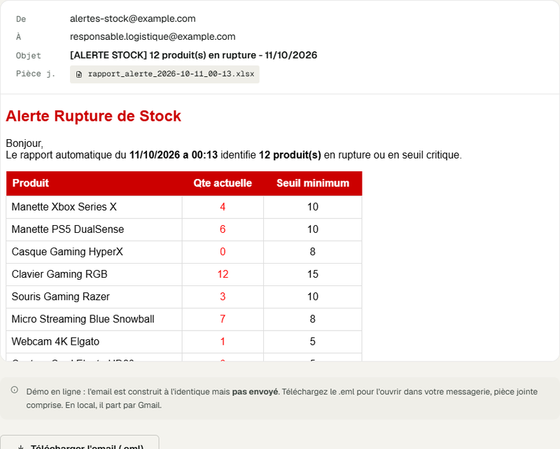 | Objet `[ALERTE STOCK] 12 produit(s) en rupture`, tableau HTML, rapport d'alerte en pièce jointe. En ligne : envoyé à l'adresse saisie dans la démo, sinon téléchargeable en `.eml` |
| Formulaire d'urgence (Cas 6) | 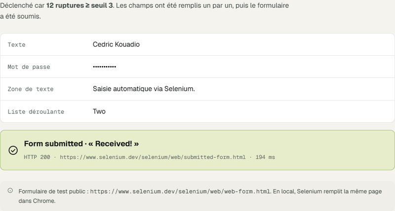 | Déclenché car 12 ruptures ≥ seuil 3 : champs saisis, puis réponse du site (« Form submitted · Received! ») |
| `rapport_semaine_*.xlsx` (Cas 2) | 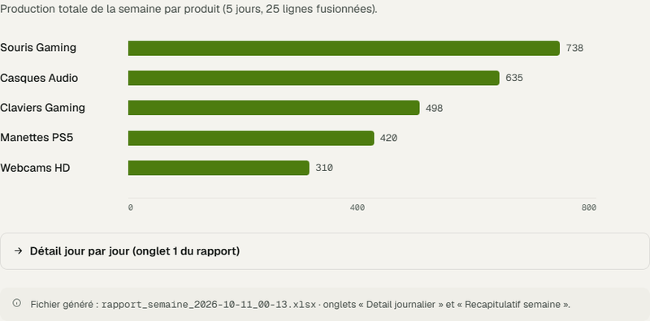 | Onglet « Detail journalier » (25 lignes) et onglet « Recapitulatif semaine » (total par produit) |
| `scraping_produits_*.xlsx` (Cas 5) | 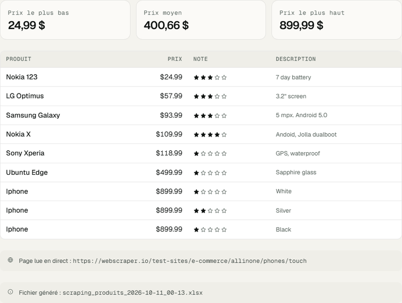 | `Produit`, `Prix`, `Description`, `Note (/ 5)` pour chaque fiche du catalogue |
| Planification (Cas 4) | 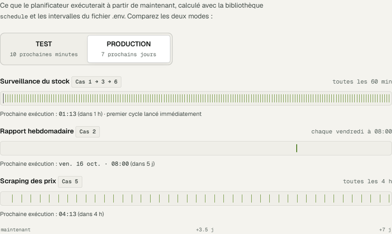 | Prochaines exécutions de chaque tâche en TEST (10 minutes) et en PRODUCTION (7 jours) |

## 10. Analyses et résultats détaillés

### Performance

| Mesure | Valeur |
|---|---|
| Cycle complet en ligne (six automatisations, catalogue lu en direct) | environ 0,6 s mesurées en production |
| dont détection des ruptures et rapport d'alerte (20 produits) | 12 à 45 ms |
| dont relevé du catalogue en ligne | environ 0,5 s (ou rien si lu il y a moins de 10 minutes) |
| Interventions humaines nécessaires | aucune une fois le mode choisi |
| Fichiers produits par cycle | 4 classeurs Excel et 1 email |
| Poids de la page d'accueil | environ 114 Ko transférés, 18 requêtes |

### Ce que le pipeline décide sur les trois inventaires (seuil du formulaire : 3)

| Inventaire | Produits | En rupture | Email | Formulaire | Production de la semaine | Catalogue relevé |
|---|---|---|---|---|---|---|
| Gaming et multimédia | 20 | 12 (60 %) | envoyé | soumis | 2 601 unités, en tête : souris gaming (738) | 9 téléphones |
| Consommables de bureau | 20 | 7 (35 %) | envoyé | soumis | 13 100 unités, en tête : stylos (5 730) | 21 tablettes |
| Stockage et sécurité | 20 | 9 (45 %) | envoyé | soumis | 3 322 unités, en tête : clés USB 64 Go | 3 ordinateurs |

Avec un seuil de 10, seul l'inventaire gaming déclenche encore le formulaire ; en remontant quelques quantités dans la démo, l'email lui-même disparaît quand il n'y a plus aucune rupture. Ces chiffres proviennent de données fictives : ils illustrent les décisions du pipeline, pas la situation d'une entreprise réelle.

### Exemple : consommables de bureau

| Produit | Quantité | Seuil |
|---|---|---|
| Ruban adhesif double face | 0 | 10 |
| Intercalaires carton x100 | 0 | 10 |
| Agrafeuse + agrafes | 2 | 5 |
| Multiprise Parafoudre 6P | 3 | 5 |
| Hub USB 3.0 7 Ports | 5 | 8 |
| Chemise cartonnee x20 | 6 | 8 |
| Cable Lightning 1m | 8 | 15 |

Sept produits sur vingt : l'email part avec ces sept lignes et le rapport en pièce jointe, et le formulaire d'urgence est soumis (7 ≥ 3).

## 11. Utilisation au quotidien

### Lancer la surveillance

```bash
python main.py
```

Deux questions, puis tout est automatique :

```
  Fichiers inventaire disponibles
  1. inventaire_consommables_bureau.xlsx
  2. inventaire_gaming_multimedia.xlsx
  3. inventaire_stockage_securite.xlsx
  Selectionnez un fichier (1-3) : 1

  Mode d'execution
  1. TEST       — intervalles courts (minutes)
  2. PRODUCTION — intervalles reels  (heures/semaine)
  Selectionnez un mode (1 ou 2) : 2

  Mode PRODUCTION actif :
    Surveillance stock  : toutes les 60 minutes
    Scraping produits   : toutes les 4 heure(s)
    Rapport hebdo       : chaque friday a 08:00
  Arret : Ctrl+C
```

Les fichiers sont déposés dans `output/<inventaire>/`. Pour une exécution durable sur un serveur, lancer le programme via un service système (Planificateur de tâches Windows, systemd).

### Tester un cas isolé

Chaque script se lance aussi seul (il cible alors l'inventaire gaming) :

```bash
python scripts/cas1_stock.py       # rapport d'alerte
python scripts/cas2_fusion.py      # rapport hebdomadaire
python scripts/cas3_email.py       # email réellement envoyé
python scripts/cas4_planifie.py    # surveillance seule, en boucle
python scripts/cas5_scraping.py    # relevé du catalogue (Chrome visible)
python scripts/cas6_formulaire.py  # formulaire (Chrome sans interface)
```

### Configuration

Tout se règle dans le fichier `.env` (copie de [`.env.example`](.env.example)), source unique de vérité :

```ini
# Email (Cas 3)
EMAIL_EXPEDITEUR=votre.adresse@gmail.com
MOT_DE_PASSE_APP=xxxx xxxx xxxx xxxx
EMAIL_DESTINATAIRE=responsable@entreprise.com

# Intervalles TEST (minutes) et PRODUCTION
TEST_INTERVALLE_STOCK_MINUTES=1
TEST_INTERVALLE_RAPPORT_MINUTES=2
TEST_INTERVALLE_SCRAPING_MINUTES=3
PROD_INTERVALLE_STOCK_MINUTES=60
PROD_INTERVALLE_SCRAPING_HEURES=4
PROD_JOUR_RAPPORT_HEBDO=friday

# Nombre de ruptures qui déclenche le formulaire (Cas 6)
SEUIL_DECLENCHEMENT_FORMULAIRE=3

# Une URL de catalogue par inventaire (Cas 5) et le formulaire (Cas 6)
SCRAPING_URL_GAMING_MULTIMEDIA=https://webscraper.io/test-sites/e-commerce/allinone/phones/touch
SCRAPING_URL_CONSOMMABLES_BUREAU=https://webscraper.io/test-sites/e-commerce/allinone/computers/tablets
SCRAPING_URL_STOCKAGE_SECURITE=https://webscraper.io/test-sites/e-commerce/allinone/computers
FORMULAIRE_URL=https://www.selenium.dev/selenium/web/web-form.html
FORM_TEXTE=Votre Nom
FORM_PASSWORD=MotDePasse123
FORM_TEXTAREA=Saisie automatique via Selenium.
FORM_SELECT=Two
```

**Mot de passe d'application Gmail** : compte Google > Sécurité > activer la validation en 2 étapes > Mots de passe des applications > générer, puis copier le code de 16 caractères dans `MOT_DE_PASSE_APP`.

Sans fichier `.env` (cas de l'hébergement en ligne), `config.py` lit `.env.example`.

## 12. Principaux enseignements

**Sur la démarche**
- **Découper une routine en tâches indépendantes** rend chacune testable seule, et permet de les recombiner : le pipeline, la planification et l'application web réutilisent les mêmes scripts.
- **Un automate doit expliquer ses décisions** : « 7 ruptures < seuil 10 : formulaire non déclenché » rassure davantage qu'une action silencieuse.

**Sur l'automatisation du web**
- **Un site peut changer sans prévenir** : la boutique de test a remplacé ses icônes `glyphicon-star` par `ws-icon-star`. Selenium ne levait aucune erreur, la note valait simplement 0 pour tous les produits. Lire l'attribut `data-rating`, plus stable que l'affichage, a corrigé le problème.
- **Soumettre un formulaire comme un navigateur**, c'est envoyer aussi les valeurs par défaut (case cochée, option sélectionnée, champ en lecture seule) et jamais les champs désactivés. Reproduire ce comportement en HTTP a permis de faire tourner le Cas 6 là où Chrome n'existe pas.
- **Ménager les sites visités** : en ligne, le catalogue n'est lu qu'une fois toutes les 10 minutes, quel que soit le nombre de visiteurs.

**Sur les données et le code**
- **Un tri par défaut peut trahir l'ordre métier** : les fichiers `Jeudi.csv`, `Lundi.csv`… triés par nom mettaient le jeudi en tête du rapport hebdomadaire. Les jours sont désormais remis dans l'ordre de la semaine.
- **Une donnée importée finit dans un email** : un nom de produit contenant du HTML s'affichait tel quel dans l'alerte. Il est maintenant échappé.
- **Une configuration incomplète doit échouer tôt** : `config.py` refuse de démarrer si une variable manque et dit laquelle.

**Sur la mise en ligne**
- **Une démo publique ne doit pas pouvoir nuire** : laisser n'importe quel visiteur déclencher un email pourrait en faire un relais de spam. L'envoi réel n'est donc possible qu'avec un contenu verrouillé et sous des limites de débit, depuis un compte dédié, et Gmail n'envoyant que depuis le compte authentifié, l'adresse d'expéditeur du visiteur devient un « Répondre à ».
- **Le serveur n'est pas à l'heure du visiteur** : l'hébergeur tournant en UTC, « chaque vendredi à 08:00 » s'affichait 10:00 pour un visiteur en France. Fixer le fuseau a corrigé le calendrier ; il a fallu ensuite le limiter à Linux, car Windows interprète mal ce réglage.
- **Un code HTTP peut être réécrit en route** : en production, le proxy de Streamlit Community Cloud remplaçait chaque réponse 422 (« données invalides ») par une page « Internal server error. », alors qu'en local tout fonctionnait. Les erreurs de validation passent donc en 400, et l'interface les reconnaît à leur contenu plutôt qu'à leur code.
- **Une démo se vérifie là où elle tourne** : sur Streamlit Community Cloud, l'interface est servie dans une iframe sous `/~/+/` ; adresses relatives et message `GUEST_READY` sont indispensables, ce qu'aucun test local ne révèle.

**Sur l'interface**
- **Une animation doit expliquer quelque chose** : le parcours de la donnée dans le pipeline, l'étape en cours, le passage d'une vue à l'autre. Le tableau de bord du hero joue une fois, puis s'arrête.
- **La couleur ne suffit pas** : rouge et vert se confondent en deutéranopie ; une rupture porte toujours une icône et un libellé.
- **Une identité visuelle se décide** : ce projet a sa propre palette et sa propre typographie, pour ne pas ressembler aux autres projets du portfolio.

## 13. Structure du projet

```
automatisation-de-processus/
├── README.md
├── main.py                      Point d'entrée en ligne de commande (2 questions)
├── scheduler.py                 PipelineScheduler : enchaîne les cas, modes TEST et PRODUCTION
├── config.py                    Configuration centrale, lue dans .env
├── app.py                       Point d'entrée web : st.App sert l'interface et l'API
├── .env.example                 Modèle de configuration (à copier en .env)
├── requirements.txt             Dépendances d'exécution
├── requirements-dev.txt         Dépendances de développement (tests)
├── packages.txt                 Paquets système pour Streamlit Cloud (fuseaux horaires)
├── Dockerfile                   Image de l'application web
├── render.yaml                  Déploiement sur Render (Blueprint)
├── .gcloudignore                Fichiers exclus d'un déploiement Cloud Run
├── scripts/
│   ├── cas1_stock.py            1. Détection des ruptures, rapport d'alerte
│   ├── cas2_fusion.py           2. Fusion des CSV de production, rapport hebdomadaire
│   ├── cas3_email.py            3. Email d'alerte HTML avec pièce jointe (Gmail)
│   ├── cas4_planifie.py         4. Surveillance planifiée autonome
│   ├── cas5_scraping.py         5. Scraping du catalogue (Selenium)
│   ├── cas6_formulaire.py       6. Formulaire d'urgence (Selenium)
│   └── config.py                Redirecteur vers config.py
├── webapp/
│   ├── api.py                   Routes web : page, import, pipeline en flux, téléchargements
│   ├── service.py               Le pipeline exécuté à la demande, fichiers gardés en mémoire
│   ├── navigateur.py            Cas 5 et 6 en HTTP, sans navigateur
│   ├── fallback.py              Page « introuvable » (Streamlit) pour les adresses inconnues
│   ├── donnees/                 Copie de secours du catalogue
│   └── static/
│       ├── index.html           Page unique : accueil et vue exécution
│       └── assets/
│           ├── css/             tokens, base, composants, sections, exécution
│           ├── js/              point d'entrée, motion, composants, hero, démo, exécution, résultats
│           ├── fonts/           Space Grotesk, Geist, Geist Mono (variables, allégées)
│           └── img/             Favicon
├── data/
│   ├── inventaire_*.xlsx        Les 3 inventaires d'exemple
│   └── production/              5 CSV journaliers par inventaire
├── tests/                       Tests automatisés (pytest)
├── assets/video/                Présentation : vidéo, affiche, musique, page web, générateur Python
├── docs/                        Guide de déploiement, captures de l'application
├── .streamlit/                  Réglages du serveur Streamlit
├── .github/                     Tests à chaque push, visite de la démo toutes les 6 h
└── output/                      Fichiers générés en local (non versionnés)
```

## 14. Reproduire le projet

**Option 1 : tester en ligne (recommandé, aucune installation)**

1. Ouvrir la [démo en ligne](https://automatisation-de-processus-cedric.streamlit.app). Si personne ne l'a ouverte depuis 12 heures, Streamlit affiche une page de mise en veille : cliquer sur le bouton de réveil, puis patienter environ une minute.
2. Cliquer sur **Lancer le pipeline**, ou régler la **démo interactive** (inventaire, quantités, mode, seuil), voire importer son propre fichier.
3. Pour recevoir l'alerte par email : renseigner **Destinataire** (`EMAIL_DESTINATAIRE`) à l'étape 03 avant de lancer. Elle peut arriver dans les indésirables la première fois.
4. Télécharger les fichiers générés, un par un ou en .zip.

**Option 2 : installer le projet sur son poste**

Prérequis : [Python 3.11 ou plus récent](https://www.python.org/downloads/), et Google Chrome pour les Cas 5 et 6.

```bash
git clone https://github.com/GomuGomuNo01/automatisation-de-processus.git
cd automatisation-de-processus
python -m venv .venv
source .venv/bin/activate            # Windows : .venv\Scripts\activate
pip install -r requirements.txt
cp .env.example .env                 # puis renseigner les identifiants Gmail (Cas 3)

python main.py                       # surveillance en boucle (Ctrl+C pour arrêter)
streamlit run app.py                 # application web sur http://localhost:8501
```

**Option 3 : sans installer Python**

- **Docker** : `docker build -t relais .` puis `docker run -p 8501:8501 relais`, et ouvrir http://localhost:8501.

**Lancer les tests :**

```bash
pip install -r requirements-dev.txt
pytest
```

**Mettre l'application en ligne**

La démo publique est hébergée sur **Streamlit Community Cloud** ([automatisation-de-processus-cedric.streamlit.app](https://automatisation-de-processus-cedric.streamlit.app)) : gratuite, sans carte bancaire, et redéployée automatiquement à chaque push sur `main`. Pour la publier depuis son propre compte : [share.streamlit.io](https://share.streamlit.io) > **Create app** > dépôt, branche `main`, fichier `app.py`, Python 3.12, puis un sous-domaine libre. Pour que les visiteurs reçoivent l'alerte par email, ajouter dans **Settings > Secrets** les identifiants d'un compte Gmail dédié à la démo (`EMAIL_EXPEDITEUR`, `MOT_DE_PASSE_APP`) ; sans ces secrets, la démo fonctionne et l'email se télécharge en `.eml`.

Le guide complet, avec les autres hébergeurs, est dans [`docs/DEPLOIEMENT.md`](docs/DEPLOIEMENT.md). En résumé :

| Hébergeur | Coût | Premier visiteur après une période calme | Fichiers fournis |
|---|---|---|---|
| **Streamlit Community Cloud** (démo actuelle) | 0 €, sans carte | page de mise en veille à cliquer après 12 h sans visite, puis environ 1 minute | [`app.py`](app.py), [`requirements.txt`](requirements.txt), [`packages.txt`](packages.txt) |
| **Google Cloud Run** | environ 0 € par mois, carte bancaire requise | quelques secondes | [`Dockerfile`](Dockerfile), [`.gcloudignore`](.gcloudignore) |
| **Render** (gratuit, sans carte) | 0 € | environ 1 minute, sauf avec le maintien en éveil | [`render.yaml`](render.yaml), [`garder-eveille.yml`](.github/workflows/garder-eveille.yml) |

**Maintien en éveil** : Streamlit met la démo en veille après 12 heures sans visite. Le workflow [`reveil-streamlit.yml`](.github/workflows/reveil-streamlit.yml) l'ouvre dans un vrai navigateur toutes les 6 heures, clique sur le bouton de réveil si besoin et lance le pipeline ; en cas d'échec, GitHub envoie un e-mail avec une capture de la page. Il ne tourne que si la **variable de dépôt `STREAMLIT_URL`** contient l'adresse de la démo (*Settings > Secrets and variables > Actions > Variables*) : c'est le cas ici. Pour l'essayer : **Actions > Réveiller la démo Streamlit > Run workflow**.

À savoir sur Streamlit Community Cloud : après un push qui modifie une route du serveur ([`webapp/api.py`](webapp/api.py) ou [`app.py`](app.py)), il faut redémarrer l'application (**Manage app > Reboot app**), car les routes ne sont créées qu'au démarrage.

**Problèmes courants**

| Problème | Cause | Solution |
|---|---|---|
| `RuntimeError: Variable manquante dans .env` | Une clé du modèle manque dans `.env` | Comparer avec [`.env.example`](.env.example) et ajouter la clé citée |
| `SMTPAuthenticationError` (Cas 3) | Mot de passe Gmail habituel au lieu d'un mot de passe d'application | Activer la validation en 2 étapes et générer un mot de passe d'application |
| Chrome introuvable (Cas 5 et 6) | Google Chrome n'est pas installé | Installer Chrome ; Selenium Manager télécharge le pilote tout seul |
| Aucun email envoyé | Aucune rupture dans l'inventaire | Comportement normal : l'email ne part que s'il y a au moins une rupture |
| Le formulaire ne se déclenche pas | Moins de ruptures que `SEUIL_DECLENCHEMENT_FORMULAIRE` | Baisser le seuil, ou vérifier le nombre de ruptures affiché |
| Le planificateur s'arrête | Le terminal a été fermé | Lancer `python main.py` via un service système |

## 15. Limites et pistes d'amélioration

**Limites**
- **Données fictives** : inventaires et production sont construits pour contenir des ruptures ; les chiffres illustrent les décisions du pipeline, pas une situation réelle.
- **Sites de test** : le scraping et le formulaire visent deux sites publics prévus pour cet usage. Viser un autre site demande d'adapter les sélecteurs et les noms de champs.
- **Envoi d'email encadré en ligne** : l'alerte n'est envoyée qu'avec un inventaire d'exemple, dans la limite de 3 envois par heure, 2 par adresse et par jour et 50 par jour, et toujours depuis le compte de la démo ; elle peut arriver dans les indésirables. Les limites sont gardées en mémoire et repartent de zéro au redémarrage du serveur.
- **Planificateur simple** : il fonctionne tant que le processus reste lancé ; il ne remplace pas un ordonnanceur système.
- **Inventaire importé** : le relevé de prix utilise alors la catégorie « téléphones » par défaut, et le rapport hebdomadaire n'est produit que si les CSV de production sont joints.
- **Fichiers en mémoire** : en ligne, les fichiers restent téléchargeables une heure, sur une seule instance du serveur.
- **Hébergement gratuit** : après 12 heures sans visite, la démo en ligne se met en veille ; une tâche GitHub Actions la visite toutes les 6 heures pour l'éviter (variable de dépôt `STREAMLIT_URL`), mais GitHub suspend ces tâches après 60 jours sans activité sur le dépôt.

**Pistes d'amélioration**
- Envoyer les alertes aussi sur **Teams ou Slack**, et confirmer l'adresse du visiteur par un code avant l'envoi.
- Garder un **historique des ruptures** pour repérer les produits qui reviennent souvent sous leur seuil.
- Lire les stocks directement depuis une **base de données** ou l'API d'un ERP plutôt que depuis Excel.
- **Comparer les prix relevés** aux prix de l'entreprise et signaler les écarts.
- Gérer **plusieurs inventaires en parallèle** (plusieurs entrepôts) dans un même pipeline.
- Confier la planification à un **ordonnanceur système** (cron, Planificateur de tâches) pour survivre aux redémarrages.

## 16. Crédits

- Polices de l'interface : [Space Grotesk](https://fonts.google.com/specimen/Space+Grotesk), [Geist et Geist Mono](https://vercel.com/font) (SIL Open Font License).
- Bibliothèques : pandas, openpyxl, Selenium, schedule, python-dotenv, Streamlit, Starlette, pytest ; Playwright pour la visite automatique de la démo.
- Vidéo de présentation : animée avec [Pillow](https://python-pillow.org), encodée avec ffmpeg ; musique composée et synthétisée pour le projet par [`music.py`](assets/video/source/music.py), sans aucun échantillon externe, libre de droits.
- Sites de test automatisés : boutique de [webscraper.io](https://webscraper.io/test-sites) et formulaire de [selenium.dev](https://www.selenium.dev/selenium/web/web-form.html).

**Auteur :** Dibie Elisee Jules Cedric KOUADIO ([@GomuGomuNo01](https://github.com/GomuGomuNo01))
